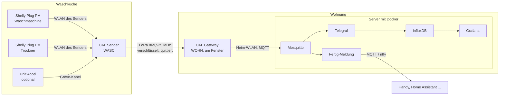

# LoRa-Waschküche

Meldet, wann Waschmaschine und Trockner fertig sind, auch wenn sie in einer Waschküche ohne WLAN und ohne Netzwerk stehen, zum Beispiel im Keller eines anderen Hauses. Zwei Messsteckdosen (Shelly Plug PM Gen3) messen die Leistung, ein kleines Funkmodul (M5Stack Unit C6L) funkt die Werte per LoRa in die Wohnung, ein zweites C6L am Fenster gibt sie per MQTT an einen Server weiter. Der Server erkennt aus der Leistung, wann ein Waschgang fertig ist, und schickt eine Meldung (MQTT, auf Wunsch als Push aufs Handy über ntfy). Ein Grafana-Dashboard zeigt Leistung, Funkstrecke und Verbrauch.

Optional misst ein Beschleunigungssensor an der Waschmaschine die Vibration (Schleuderdrehzahl, Frequenzbänder), als Grundlage, um später das Programm zu erkennen.



Funk: LoRa von Punkt zu Punkt mit einem eigenen Schlüssel, **kein LoRaWAN** (braucht kein Gateway eines Netzbetreibers) und kein Meshtastic. Im Original-Aufbau liegen rund vier Stockwerke und eine Hauswand zwischen Waschküche und Fenster; dort kommen die Pakete mit etwa 20 dB Reserve an. Wie weit es bei dir reicht, zeigt der [Reichweitentest](#reichweitentest-firmware-lora-test) vorher.

| Ordner | Inhalt |
| --- | --- |
| `firmware/waschkueche` | Firmware für beide C6L (die Rolle Sender oder Gateway steht beim Bauen fest) |
| `firmware/lora-test` | Reichweitentest, vor dem Kauf der übrigen Teile sinnvoll |
| `skripte` | `secrets.h` anlegen, bauen und aufspielen (USB oder über WLAN), macOS und Linux |
| `server` | Docker-Compose mit Mosquitto, InfluxDB, Telegraf, Grafana (Dashboard, Alarme) und der Fertig-Meldung |
| `halterung` | 3D-Druck: Halter für den C6L auf einem USB-C-Netzteil, Halter für den Sensor an der Waschmaschine |
| `test` | Test der Vibrations-Auswertung am Rechner |

Zugangsdaten (WLAN, Passwörter, LoRa-Schlüssel) stehen nur in `firmware/waschkueche/secrets.h` und `server/.env`. Beide Dateien legen Skripte an, beide stehen in `.gitignore` und gehören nie in ein Repo.

---

## Einkaufsliste

| Teil | Anzahl | Hinweis |
| --- | --- | --- |
| M5Stack Unit C6L (ESP32-C6 mit LoRa SX1262, 868 MHz) | 2 | einer als Sender, einer als Gateway; 868-MHz-Antenne senkrecht anschrauben |
| Shelly Plug PM Gen3 (S3PL-30116EU) | 2 | je Maschine einer; misst nur, hat **kein Relais**, 16 A / 3680 W. Jede Maschine an eine eigene Wandsteckdose |
| USB-C-Netzteil | 2 | eins je C6L. Der Halter unten passt auf das offizielle Raspberry-Pi-Netzteil (EU, 15,3 W). Keine Powerbank: viele schalten beim kleinen Strom des C6L ab |
| Steckdosenleiste mit USB-C | 0–1 | nur nötig, wenn die Steckdosen in der Waschküche knapp sind (siehe [Aufbau](#aufbau-in-der-waschküche)) |
| M5Stack Unit Accel (U056, ADXL345) | 0–1 | optional, Vibration der Waschmaschine; mit Grove-Kabel (HY2.0-4P), getestet mit 50 cm |
| Server | 1 | irgendein Rechner mit Docker, der durchläuft (Raspberry Pi 4/5, NAS, Mini-PC). Ein vorhandener MQTT-Broker oder Home Assistant geht auch |

Für die gedruckten Halter: PETG, je C6L-Halter 4 Gewindeeinsätze **M4 short** (z. B. CNC Kitchen M4×4) und 4 Schrauben **M4×12**, für den Sender ein Kabelbinder 3 × 1,5 mm. Sensor-Halter: 2 Einsätze, 2 Schrauben M4×12, VHB-Klebeband, Kabelbinder 2,5 mm.

---

## Werkzeuge

Gebaut wird mit **arduino-cli** auf macOS oder Linux.

```bash
# macOS: brew install arduino-cli
# Linux: curl -fsSL https://raw.githubusercontent.com/arduino/arduino-cli/master/install.sh | sh
arduino-cli config init
arduino-cli config add board_manager.additional_urls https://espressif.github.io/arduino-esp32/package_esp32_index.json
arduino-cli core update-index
arduino-cli core install esp32:esp32
```

Die Bibliotheken (RadioLib, U8g2, ArduinoJson ab Version 7, PubSubClient) installieren die Skripte beim ersten Bauen selbst. Getestet mit arduino-cli 1.5.1, ESP32-Core 3.3.12, RadioLib 7.8.1, U8g2 2.36.19, ArduinoJson 7.4.3 und PubSubClient 2.8. Außerdem nötig: `openssl`, `python3` (für das Update über WLAN) und `curl`. Unter Linux muss der eigene Benutzer auf `/dev/ttyACM0` zugreifen dürfen (meist Gruppe `dialout`).

Den C6L per USB-C anschließen. Er erscheint unter macOS als `/dev/cu.usbmodem…`, unter Linux als `/dev/ttyACM…`. Springt er beim Aufspielen nicht in den Download-Modus: Taster gedrückt halten, USB einstecken, bis die LED rot wird, dann noch einmal aufspielen.

---

## Schritt für Schritt

### 1. Reichweitentest (empfohlen)

Bevor Shellys und Halter gekauft werden: mit beiden C6L prüfen, ob die Strecke reicht. Siehe [Reichweitentest](#reichweitentest-firmware-lora-test) weiter unten. Danach geht es hier weiter.

### 2. Server einrichten

Auf dem Server (Docker und Docker Compose v2 nötig):

```bash
cd server
./einrichten.sh          # legt .env mit zufälligen Passwörtern und die MQTT-Benutzer an
docker compose up -d     # startet Mosquitto, InfluxDB, Telegraf, Grafana und die Fertig-Meldung
```

Grafana läuft dann auf `http://<Server>:3000` (Benutzer `admin`, Passwort `GRAFANA_PASS` aus `server/.env`), mit dem Dashboard **Waschküche**. Port 1883 (MQTT) muss aus dem Heimnetz erreichbar sein, das Gateway verbindet sich dorthin. Mehr unter [Server](#server).

Wer schon einen MQTT-Broker hat: dort einen Benutzer für das Gateway anlegen, der unter `sensors/waschkueche/#` schreiben und `sensors/waschkueche/set` lesen darf. Die übrigen Dienste aus `server/` lassen sich einzeln übernehmen.

### 3. `secrets.h` anlegen

```bash
bash skripte/waschkueche-secrets.sh
```

Das Skript fragt nach dem Heim-WLAN (2,4 GHz) für das Gateway, einem Namen für das WLAN, das der Sender für die Shellys aufspannt (jeder in der Waschküche sieht ihn, also lieber einer, der nicht verrät, worum es geht), und nach dem MQTT-Zugang (Adresse des Servers, Benutzer `waschkueche`, Passwort `MQTT_PASS_WASCHKUECHE` aus `server/.env`). LoRa-Schlüssel und alle übrigen Passwörter erzeugt es zufällig. Beide Geräte werden mit derselben `secrets.h` gebaut. Vorlage zum Ausfüllen von Hand: `firmware/waschkueche/secrets.h.example`.

### 4. Gateway (Wohnung) aufspielen

```bash
bash skripte/waschkueche-flashen.sh wohn                        # nur bauen, zeigt die USB-Ports
bash skripte/waschkueche-flashen.sh wohn /dev/cu.usbmodem1101   # per USB aufspielen
```

Das Gateway holt sich seine Adresse per DHCP. Am besten im Router fest zuordnen; wer sie lieber im Gerät festlegt, stellt in `firmware/waschkueche/config.h` `WOHN_FESTE_IP = true` und die Adressen darunter ein. Statusseite: `http://waschkueche-wohn.local/` (oder die IP, die der Router zeigt). Spätere Updates gehen über WLAN: `bash skripte/waschkueche-flashen.sh wohn ota <IP>`.

### 5. Sender (Waschküche) aufspielen

```bash
bash skripte/waschkueche-flashen.sh wasc /dev/cu.usbmodem1101
```

Das Skript löscht vorher das ganze Flash (damit verschwinden alte Firmware und ein dort gemerktes Heim-WLAN, etwa vom Reichweitentest) und prüft nach dem Bauen, dass weder Heim-WLAN noch MQTT-Zugang im Image stehen. Später, vor Ort: Rechner ins WLAN des Senders, dann `bash skripte/waschkueche-flashen.sh wasc web`.

Beide Geräte auf dem Tisch nebeneinander einschalten: Nach spätestens 5 Minuten zeigt die Statusseite des Gateways die erste Sendung, im Dashboard tauchen die Werte auf (die Maschinen noch als „nicht erreichbar“, solange die Shellys fehlen).

### 6. Shellys einrichten

Der Sender muss dafür laufen (er spannt das WLAN auf). Jeden Shelly einzeln:

1. Shelly einstecken, mit dem Handy oder Rechner in sein eigenes WLAN gehen (der Name beginnt mit „Shelly“), `http://192.168.33.1/` öffnen.
2. WLAN einrichten: Name `AP_SSID` und Passwort `AP_PASS` aus `secrets.h`, **feste IP**: Waschmaschine `192.168.4.201`, Trockner `192.168.4.202`, Maske `255.255.255.0`, Gateway `192.168.4.1`.
3. Danach **abschalten**: den eigenen Access Point des Shellys, Bluetooth und die Cloud. Keine Anmeldung (Passwort) am Shelly einschalten, die Firmware fragt ohne ab.

Die Statusseite des Senders (im WLAN des Senders unter `http://192.168.4.1/`) zeigt beide Shellys mit „ok“. Das geht bequem zu Hause, bevor alles in die Waschküche wandert.

### 7. Aufbau in der Waschküche

Beispiel mit nur zwei Wandsteckdosen: Wandsteckdose 1 → Steckdosenleiste mit USB-C → Shelly Waschmaschine und Netzteil des Senders; Wandsteckdose 2 → Shelly Trockner. Den Sender frei in den Raum stellen, Antenne senkrecht, **nicht** zwischen oder hinter die Maschinen (dort waren es im Original 20 dB weniger). Das Gateway in der Wohnung ans Fenster Richtung Waschküche.

Beschleunigungssensor (optional): Grove-Kabel an den C6L, Sensor mit dem gedruckten Halter und VHB-Band fest an eine ebene Stelle der Seitenwand der Waschmaschine, Kabel am Halter festbinden. Mehr ist nicht einzurichten.

### 8. Prüfen und Alarme einschalten

- Gateway-Statusseite: letzte Sendung, Empfang (RSSI/SNR), beide Maschinen „ok“.
- Grafana: Dashboard **Waschküche**.
- Erst wenn alles an seinem Platz hängt: in `server/grafana/provisioning/alerting/waschkueche.yaml` bei den drei Alarmen `isPaused: false` setzen, `docker compose restart grafana`. Wohin Alarme gehen, stellt man in Grafana unter *Alerting → Contact points* ein (für Mail braucht Grafana SMTP-Einstellungen, `GF_SMTP_*`).
- Ein paar Waschgänge laufen lassen und die [Schwellen der Fertig-Meldung](#fertig-meldung) prüfen.

---

## Firmware

`firmware/waschkueche`, ein Quelltext für beide C6L. Die Rolle steht beim Bauen fest (`wohn` oder `wasc`) und lässt sich am Gerät nicht umschalten. Beide Geräte brauchen dieselbe Firmware-Version (das Funkformat hängt davon ab).

- **WASC** (Sender, Waschküche) spannt ein eigenes WLAN für die zwei Shellys auf, fragt sie abwechselnd ab (je Steckdose alle 10 s) und funkt Leistung und Zählerstand verschlüsselt (AES-128-CCM) in die Wohnung. Solange eine Maschine läuft (> 5 W), sendet er alle 30 s, sonst alle 5 min, und bei jedem Wechsel sofort. Jede Sendung wird quittiert und sonst bis zu dreimal wiederholt. Display und LED gehen nach 1 min aus; der erste Tastendruck weckt sie, jeder weitere sendet sofort. Statusseite im WLAN des Senders: `http://192.168.4.1/`, Update: `http://192.168.4.1/update` (Benutzer `admin`, Passwort `OTA_PASS_WASC`).
- **WOHN** (Gateway, Fenster) empfängt, quittiert und schickt alles per MQTT an den Server. Statusseite `http://waschkueche-wohn.local/`, Einstellungen des Senders unter `/einstellungen`, Update über WLAN.
- Funk: 869,525 MHz, **SF10**, 125 kHz, 22 dBm, höchstens 6 % Sendezeit je Stunde (erlaubt sind in diesem Band 10 % und 500 mW ERP). Meshtastic in Europa nutzt dieselbe Frequenz mit einem anderen Sync-Wort; fremde Pakete verwirft die Firmware.
- Die Zahlen oben (Takt, Schwelle, Anzeigedauer) sind Vorgaben und lassen sich aus der Wohnung ändern, siehe [Einstellungen per LoRa](#einstellungen-per-lora).

### Beschleunigungssensor (M5Stack Unit Accel, ADXL345)

Optional. Ohne ihn läuft alles, auf der Statusseite steht dann „nicht gefunden“. Er wird auch erkannt, wenn er später angesteckt wird (nach höchstens 30 s).

- **Anschluss:** Grove-Kabel an den Grove-Port des C6L, nichts zu löten. Gelb = G5 = SDA, weiß = G4 = SCL, I2C-Adresse 0x53. Der C6L braucht seinen einzigen I2C-Baustein für Taster und LoRa-Reset, der Sensor läuft deshalb über Software-I2C mit rund 100 kHz (`adxl345.h`). Getestet mit 50 cm Kabel. Der Sensor hat eigene Pull-ups und Pegelwandler, längere Kabel sind denkbar; zählen auf der Statusseite des Senders die I2C-Fehler hoch, ist das Kabel zu lang oder ein Stecker locker.
- **Auswertung im Sender** (`vibration.h`): Rohdaten passen nicht durch LoRa (200 Messwerte je Sekunde und Achse). Der Sender rechnet je 2,56 s einen Rahmen mit 512 Werten je Achse: Gesamt-Vibration ohne Erdbeschleunigung, Spitze, die stärkste Linie zwischen 3 und 30 Hz (= Schleuderdrehzahl, mal 60 = U/min) und zwölf Frequenzbänder. Über die Zeit zwischen zwei Sendungen wird gemittelt, das Ergebnis hängt als 25-Byte-Block an der Sendung.
- **Trockner oben drauf:** Beide Maschinen schütteln denselben Turm. Auseinanderhalten lassen sie sich über die Leistung je Steckdose und über die Frequenz: Schleudern liegt bei 7 bis 27 Hz, die Trommel des Trockners dreht mit unter 1 Hz, Motor und Gebläse liegen bei 45 bis 55 Hz und darüber.
- **Grenzen:** In Ruhe zeigt der Sensor etwa 7 bis 15 mg Gesamt-Vibration. Schleudern liegt weit darüber; das sanfte Drehen beim Waschen kann nahe am Rauschen liegen.

| Band | Hz | typisch |
| --- | --- | --- |
| `b0` | 0,4–1,6 | Trommel beim Waschen und im Trockner |
| `b1` | 1,6–4 | Anlauf, Unwucht beim Verteilen |
| `b2` … `b7` | 4–8, 8–12, 12–16, 16–20, 20–24, 24–28 | Schleudern, je Band 240 U/min (240 bis 1680 U/min) |
| `b8` | 28–45 | |
| `b9` | 45–55 | Netzbrummen, Pumpen, Trocknermotor |
| `b10`, `b11` | 55–75, 75–95 | Gebläse, Lager |

### Einstellungen per LoRa

Der Sender lässt sich aus der Wohnung einstellen, ohne Gang in die Waschküche. Das Gateway hält die gewünschten Werte. Der Sender meldet in jeder Sendung eine Prüfsumme seiner Werte; weicht sie ab, hängt das Gateway die Einstellungen (12 Byte) an die Quittung. Es dauert also höchstens bis zum nächsten Lebenszeichen (Vorgabe 5 min), bis eine Änderung ankommt.

Ändern: Seite `/einstellungen` des Gateways oder per MQTT an `sensors/waschkueche/set`, zum Beispiel `{"senden_aktiv_s":20}` (ein oder mehrere Werte, nicht retained). Der Stand steht retained in `sensors/waschkueche/einstellungen`; `einst_ok` in `diag` ist 1, sobald der Sender dieselben Werte hat.

| Name | Bedeutung | Bereich | Vorgabe |
| --- | --- | --- | --- |
| `senden_aktiv_s` | Sendetakt, solange eine Maschine läuft | 10–600 s | 30 |
| `senden_ruhe_s` | Sendetakt sonst (Lebenszeichen), nie kürzer als `senden_aktiv_s` | 60–900 s | 300 |
| `aktiv_w` | Leistung, ab der eine Maschine als laufend gilt | 1–2000 W | 5 |
| `abfrage_s` | Abstand zwischen zwei Shelly-Abfragen (abwechselnd, je Steckdose das Doppelte) | 2–60 s | 5 |
| `anzeige_s` | Display und LED des Senders aus nach | 10–250 s | 60 |
| `sensor` | Beschleunigungssensor auswerten und mitsenden | 0/1 | 1 |
| `vib_aktiv` | Vibration zählt wie eine laufende Maschine (schneller Sendetakt) | 0/1 | 0 |
| `vib_aktiv_mg` | Schwelle dafür, Gesamt-Vibration | 5–250 mg | 30 |

Frequenz, Spreizfaktor und Sendeleistung lassen sich absichtlich **nicht** per Funk ändern: Ein falscher Wert würde genau die Strecke kappen, über die man ihn korrigiert. Neue Firmware geht ebenfalls nicht über LoRa (ein Image hat 1,2 MB, das wären bei der erlaubten Sendezeit Tage); der Sender bekommt sie vor Ort über sein WLAN (`… wasc web`).

### MQTT-Themen (`sensors/waschkueche/…`)

| Thema | Inhalt |
| --- | --- |
| `waschmaschine`, `trockner` | `{"power":W,"energy":Wh,"online":true}` bei jeder Sendung; `online` false = Sender erreicht den Shelly nicht |
| `vibration` | bei jeder Sendung mit Sensor, Werte in mg: `rms`, `rms_max`, `spitze`, `dreh_hz`/`dreh_upm`/`dreh`, `b0`…`b11`, `lage_x/y/z` (Erdbeschleunigung in g, zeigt, ob der Sensor verrutscht ist), `rahmen`, `ok`, `verworfen`, `fehler` |
| `diag` | Funkstrecke jede Minute: RSSI/SNR beider Richtungen, Zähler, Verluste, `alter_s` (Sekunden seit der letzten Sendung), `einst_ok`, `sensor_an`, `sensor_da` … |
| `einstellungen` | gewünschte Einstellungen des Senders (retained) |
| `set` | Einstellungen ändern |
| `status` | `online` / `offline` des Gateways (retained, Last Will) |
| `fertig` | von der Fertig-Meldung: `{"maschine":"trockner","text":"Der Trockner ist fertig.","zeit":…}` |
| `zustand/<maschine>` | von der Fertig-Meldung (retained): `laeuft`, `fertig`, `bereit`, `nicht_erreichbar` … |

### Funkformat

| Rahmen | Länge | Sendedauer (SF10) |
| --- | --- | --- |
| Sendung ohne Sensor | 37 Byte | 0,53 s |
| Sendung mit Vibrationsblock | 62 Byte | 0,73 s |
| Quittung | 17 Byte | 0,36 s |
| Quittung mit Einstellungen | 29 Byte | 0,44 s |

Mit Sensor und 30-s-Takt belegt der Sender 2,4 % der Stunde, in Ruhe 0,25 %. Aufbau: `funk.h`.

Test am Rechner (ohne Geräte): `g++ -std=c++17 -O2 -Wall -o /tmp/test_vibration test/test_vibration.cpp && /tmp/test_vibration`.

---

## Server

`server/docker-compose.yml` startet:

| Dienst | Aufgabe |
| --- | --- |
| `mosquitto` | MQTT-Broker, Port 1883, nur mit Benutzer und Passwort (`mosquitto/config/acl` regelt, wer was darf) |
| `influxdb` | Datenbank, Bucket `waschkueche`, Oberfläche auf Port 8086 |
| `telegraf` | schreibt `waschmaschine`/`trockner`, `diag` und `vibration` aus MQTT in die Datenbank (Measurements `waschkueche`, `waschkueche_funk`, `waschkueche_vibration`) |
| `grafana` | Dashboard **Waschküche** und drei Alarme (Gateway still, Sender still, Shelly nicht erreichbar), Port 3000 |
| `fertigmeldung` | erkennt das Ende eines Laufs und meldet es (siehe unten) |

`einrichten.sh` legt `server/.env` mit zufälligen Passwörtern an und die MQTT-Benutzer `waschkueche` (Gateway), `telegraf` und `fertigmeldung`. Ein zweiter Lauf ändert `.env` nicht.

### Fertig-Meldung

`server/fertigmeldung` liest die Leistung beider Maschinen und meldet einmal je Lauf unter `sensors/waschkueche/fertig`, dazu den Zustand je Maschine (retained) unter `sensors/waschkueche/zustand/<maschine>`.

**Push aufs Handy:** In `server/.env` `NTFY_URL=https://ntfy.sh/<langes-zufälliges-Thema>` eintragen, `docker compose up -d`, in der App *ntfy* dasselbe Thema abonnieren. Auf ntfy.sh kann jeder mitlesen, der das Thema kennt; wer mag, betreibt einen eigenen ntfy-Server (`NTFY_TOKEN` für die Anmeldung).

**Regel:** Fertig ist ein Lauf, wenn die Maschine vorher gearbeitet hat (Mittel über `ARBEIT_MIN` Minuten über `ARBEIT_W`) und die Leistung danach `STILL_MIN` Minuten durchgehend unter `STILL_W` blieb. Gemeldet wird erst, wenn eine spätere Sendung die Ruhe bestätigt; fällt der Funk mitten im Programm aus, kommt also keine falsche Meldung. Werte mit `online: false` zählen weder als Leistung noch als Ruhe.

| Maschine | `ARBEIT_W` | `ARBEIT_MIN` | `STILL_W` | `STILL_MIN` |
| --- | --- | --- | --- | --- |
| Waschmaschine | 20 W | 5 | 5 W | 4 |
| Trockner | 50 W | 5 | 5 W | 4 |

Die Vorgaben sind ein **erster Ansatz**, getestet nur mit einem nachgebauten Waschgang. Nach den ersten echten Läufen im Dashboard (Panel *Leistung*) nachsehen:

- Pausiert die Waschmaschine mitten im Programm länger als 4 min unter 5 W (Einweichen), kommt die Meldung zu früh → `WASCHMASCHINE_STILL_MIN` erhöhen.
- Der Knitterschutz eines Trockners dreht die Trommel nach dem Ende in Abständen weiter; liegt er über 5 W, kommt die Meldung erst danach → `TROCKNER_STILL_W` anheben oder hinnehmen.

Ändern über Umgebungsvariablen im Dienst `fertigmeldung` in `docker-compose.yml` (`<MASCHINE>_<WERT>`, z. B. `WASCHMASCHINE_STILL_MIN=8`), danach `docker compose up -d`. Test ohne Geräte: `cd server/fertigmeldung && python3 -m pytest` (braucht `pytest` und `paho-mqtt`).

### Home Assistant (nicht getestet)

Wer Home Assistant nutzt, kann das Gateway auch direkt an dessen Broker hängen und die Themen oben als MQTT-Sensoren einbinden, zum Beispiel:

```yaml
mqtt:
  sensor:
    - name: "Waschmaschine Leistung"
      state_topic: "sensors/waschkueche/waschmaschine"
      value_template: "{{ value_json.power }}"
      unit_of_measurement: "W"
      device_class: power
    - name: "Waschmaschine Zustand"
      state_topic: "sensors/waschkueche/zustand/waschmaschine"
      value_template: "{{ value_json.zustand }}"
```

Der Zustand kommt nur, wenn die Fertig-Meldung aus `server/fertigmeldung` am selben Broker läuft; sonst lässt sich „fertig“ auch mit einer Automation aus der Leistung bauen.

---

## Sicherheit

Eine Waschküche ist meist für alle Parteien zugänglich, also kann jeder an das Gerät und die Shellys. Ziel: Wer dort etwas anstellt, kommt nicht ins Heimnetz und erfährt kein Passwort von dort.

| Gerät | steht im Speicher (mit USB-Kabel auslesbar) | nicht drauf |
| --- | --- | --- |
| Sender Waschküche | LoRa-Schlüssel, Name und Passwort seines WLANs, `OTA_PASS_WASC` | Heim-WLAN, `OTA_PASS`, MQTT-Zugang |
| Gateway Wohnung | LoRa-Schlüssel, Heim-WLAN, `OTA_PASS`, MQTT-Zugang | `AP_PASS`, `OTA_PASS_WASC` |

- `waschkueche-flashen.sh` prüft nach jedem Bauen, dass die Werte der anderen Rolle nicht im Image stehen, und löscht es sonst.
- Schlimmstenfalls liest jemand den Sender aus und schickt mit dem LoRa-Schlüssel falsche Werte. Dann stimmt die Fertig-Meldung nicht, mehr nicht. Danach: neuen LoRa-Schlüssel erzeugen (`openssl rand -hex 16` in `secrets.h`), beide Geräte neu bauen.
- Funk: Jedes Paket ist mit AES-128-CCM verschlüsselt und geprüft, ein Zähler sperrt alte Pakete aus. Das Gateway nimmt nur steigende Zähler an und setzt ihn nie von selbst zurück. Ein gelöschter Sender startet seinen Zähler aus der Bauzeit des Images und liegt damit über allem, was er früher gesendet hat. Passt das einmal nicht (Sendungen „mit altem Zähler“ auf der Statusseite), hilft „Zähler vergessen“ auf der Seite `/einstellungen` des Gateways.
- Von außen sichtbar bleibt nur, dass und wie oft gesendet wird (30 s statt 5 min verrät, dass eine Maschine läuft). Das Gateway nimmt über Funk keine Befehle an; der Sender nimmt mit der Quittung nur die Einstellungen aus der Tabelle oben an, jede in ihrem festen Bereich.
- Die Seiten des Gateways sind ohne Anmeldung aus dem Heimnetz erreichbar. Speichern darf nur das eigene Formular (Prüfung der Herkunft): Eine fremde Webseite im Browser kann nichts verstellen. Hinter einem Reverse-Proxy mit HTTPS muss der Proxy deshalb den `Origin`-Header auf `http://<Name des Gateways>` umschreiben, sonst antwortet das Gateway beim Speichern mit 403.
- Shelly zurücksetzen oder abziehen stoppt nur die Werte; nach 30 min meldet der Alarm „Steckdose nicht erreichbar“. Die Shelly Plug PM Gen3 haben kein Relais, abschalten lässt sich darüber nichts.
- Nicht eingebaut: Flash-Verschlüsselung und Secure Boot des ESP32-C6. Sie brennen eFuses dauerhaft, danach geht USB-Flashen nur noch mit dem Schlüssel und Fehler lassen sich kaum beheben.
- Die Test-Firmware (`lora-test`) enthält das Heim-WLAN. Mit ihr nichts in der Waschküche liegen lassen.

---

## Reichweitentest (Firmware `lora-test`)

`firmware/lora-test`, für beide Geräte, SF12, 125 kHz, 22 dBm. Ein Gerät ist **WOHN** (im WLAN, zeigt alles auf `http://waschkueche-wohn.local/`, `/api/status` als JSON), das andere **WASC** (Waschküche, ohne WLAN). Die Werte stehen nur im RAM.

### Aufspielen

1. Einmalig `firmware/lora-test/secrets.h` aus `secrets.h.example` anlegen (Heim-WLAN, eigenes OTA-Passwort). Ohne die Datei läuft WOHN ohne WLAN, die Anzeige am Gerät geht trotzdem.
2. `bash skripte/lora-test-flashen.sh` baut die Firmware und zeigt die Ports.
3. `bash skripte/lora-test-flashen.sh /dev/cu.usbmodem1101 loeschen` leert das Flash und spielt auf. Achtung: Das ersetzt die Firmware auf dem Gerät (ab Werk oft Meshtastic).
4. Mit dem zweiten Gerät wiederholen. Beide starten als **WOHN**.
5. Am Gerät für die Waschküche den Taster **3 s halten**, bis „Rolle: WASC“ erscheint.

### Messen

1. **WOHN** mit USB-Netzteil ans Fenster Richtung Waschküche, Antenne senkrecht. Die LED blinkt bei jedem Ping blau.
2. **WASC** am USB-Netzteil in die Waschküche. Etwa alle 28 s geht ein Ping raus. LED grün = Antwort kam, rot = verloren.
3. Je Messpunkt: an WASC den Taster **kurz** drücken (zeigt „Punkt 2“, „Punkt 3“ …) und mindestens 5 Minuten liegen lassen. WOHN legt dafür eine neue Zeile an. Taster nie länger halten: nach 3 s wechselt die Rolle.

| Zeile am WASC | Bedeutung |
| --- | --- |
| `WASC #12 P2` | Nummer des letzten Pings, Messpunkt |
| `hin -112 -8` | Waschküche → Wohnung: RSSI dBm, SNR dB (gemessen bei WOHN) |
| `zur -110 -7` | Wohnung → Waschküche |
| `ok 11/12` | Antworten / gesendete Pings |
| `min -9.5dB` | schlechteste SNR an diesem Messpunkt |
| `SF9 geht` | schnellster Spreizfaktor mit 5 dB Reserve; `zu knapp` = selbst SF12 hat weniger; `kein Empfang` |

Die echte Firmware sendet mit **SF10**, das reicht bis etwa −15 dB SNR. Zeigt der Test an der gewünschten Stelle `SF10 geht` oder schneller, passt es. Beispiel aus dem Original-Aufbau:

| Stelle | Waschküche → Wohnung | Wohnung → Waschküche | Verluste |
| --- | --- | --- | --- |
| Waschküche, freier Raum (5 Stellen) | −61 bis −66 dBm, SNR +1,5 bis +5 | −60 bis −63 dBm | 0 |
| zwischen den Gerätetürmen auf dem Trockner | −80 / −84 dBm, SNR −6 / −10 | – | 0 |

Im freien Raum bleiben mit SF10 rund 19 dB Reserve, zwischen den Türmen nur etwa 5 dB. Danach die echte Firmware aufspielen (Schritt 4 und 5 oben; der Sender wird dabei ganz gelöscht).

Zurück zu Meshtastic: https://flasher.meshtastic.org, Gerät „M5Stack Unit C6L“.

---

## Halterungen (`halterung/`)

### C6L auf dem USB-C-Netzteil

Hält den C6L auf dem offiziellen Raspberry-Pi-USB-C-Netzteil (EU, 15,3 W). Drei Teile:

| Datei | Teil |
|---|---|
| `c6l_halterung_wohn.stl` | Platte für das Gateway, C6L mittig |
| `c6l_halterung_wasc.stl` | Platte für den Sender, C6L 20 mm höher, darunter Platz für das Grove-Kabel und ein Tunnel für einen Kabelbinder |
| `usb_buegel.stl` | Bügel über dem USB-C-Stecker, passt auf beide Platten |

**Platte:** 6 mm dick, vier Löcher für Gewindeeinsätze **M4 short** (Bohrung 5,8 mm, 5 mm tief). Zwei sitzen genau unter den beiden Lego-Löchern des C6L (16 mm Abstand, 12 mm vom Grove-Ende), zwei daneben für den Bügel (30 mm Abstand, mittig zur USB-C-Buchse 21,5 mm vom Grove-Ende). Der C6L wird mit 2× **M4×12** von vorn festgeschraubt, das Grove-Ende zeigt nach unten.

**Bügel:** U-Form über dem festen Teil des USB-C-Steckers, innen 12,0 mm breit (klemmt einen 12 mm breiten Stecker) und 8,2 mm hoch, mit 2× **M4×12** von oben verschraubt. Langlöcher (± 1 mm): erst über den Stecker drücken, dann festschrauben. Andere Stecker: Maße in `c6l_halterung.py` anpassen.

**Druck:** Platte flach aufs Bett, Beine nach oben, ohne Stütze. Der Bügel liegt in der STL schon richtig.

`python3 c6l_halterung.py Koerper1.stl` erzeugt alle drei STL neu (`pip install trimesh manifold3d shapely numpy`), `python3 vorschau.py` die Bilder und prüft, dass sich Bügel, Stecker, C6L und Platte nicht durchdringen. Die Lage der USB-C-Buchse (21,5 mm vom Grove-Ende) stammt aus dem Gehäusemodell von M5Stack; beim ersten Druck nachmessen.

### Sensor an der Waschmaschine (`accel_halterung.stl`)

Für den M5Stack Unit Accel (24 × 32 × 8 mm): Klebeplatte 60 × 80 × 3 mm, in der Mitte ein Sockel mit zwei Gewindeeinsätzen **M4 short** unter den Lego-Löchern des Sensors, 2× **M4×12** von vorn. Ein Rand an drei Seiten hält ihn gerade. Die glatte Rückseite klebt mit VHB-Band an einer ebenen Stelle der Seitenwand; vorher beide Flächen mit Isopropanol entfetten. Vor dem Grove-Ende steht ein Steg mit Tunnel für einen Kabelbinder (2,5 mm): Kabel dort festbinden, sonst misst der Sensor das schwingende Kabel mit.

Druck: Klebeseite flach aufs Bett, ohne Stütze. Beim Einschmelzen der Einsätze die Platte auf eine ebene Fläche legen. `python3 accel_halterung.py` erzeugt die STL neu, `python3 accel_vorschau.py accel_halterung.stl accel_halterung_vorschau.png` die Bilder.

---

## Fehlersuche

| Beobachtung | Ursache, Abhilfe |
| --- | --- |
| Aufspielen bricht ab, Port fehlt | Taster halten, USB einstecken bis die LED rot wird, nochmal; anderes USB-Kabel (manche laden nur) |
| `waschkueche-wohn.local` geht nicht | Manche Netze lösen `.local` nicht auf: IP im Router nachsehen |
| Statusseite Gateway: MQTT „getrennt“ | `MQTT_HOST`/Passwort in `secrets.h` prüfen, Port 1883 am Server erreichbar? Log: `docker compose logs mosquitto` |
| Keine Sendung aus der Waschküche | Sender an? Display mit Taster wecken: zeigt den letzten Empfang der Quittung. Beide mit derselben `secrets.h` und Version gebaut? |
| Sendungen „mit altem Zähler“ verworfen | auf `/einstellungen` des Gateways „Zähler vergessen“ |
| Maschine „nicht erreichbar“ | Shelly im WLAN des Senders? Feste IP `.201`/`.202` gesetzt? Statusseite des Senders zeigt beide |
| I2C-Fehler am Sensor zählen hoch | Kabel zu lang oder Stecker locker |
| Fertig-Meldung zu früh oder zu spät | Schwellen nachstellen, siehe [Fertig-Meldung](#fertig-meldung) |

---

## Lizenz

Firmware, Skripte, Server-Teil und Anleitung: MIT, siehe `LICENSE`.

Ausnahme `halterung/`: Die Beine der C6L-Halterung stammen aus „Raspberry pi 4 b mount for the orginal power supply“ von Rene Soukup, https://www.printables.com/model/578212 (`Koerper1.stl`), Lizenz **CC BY-NC**. Die daraus abgeleiteten Halter (`c6l_halterung_*.stl`, `usb_buegel.stl`, `c6l_halterung.py`) stehen deshalb ebenfalls unter CC BY-NC, also nur für nicht-kommerzielle Nutzung mit Namensnennung. Siehe `halterung/LIZENZ.md`.

Keine Gewähr: Die Shellys hängen an 230 V. Steckdosen, Mehrfachstecker und Kabel müssen für die Leistung der Maschinen ausgelegt sein.
